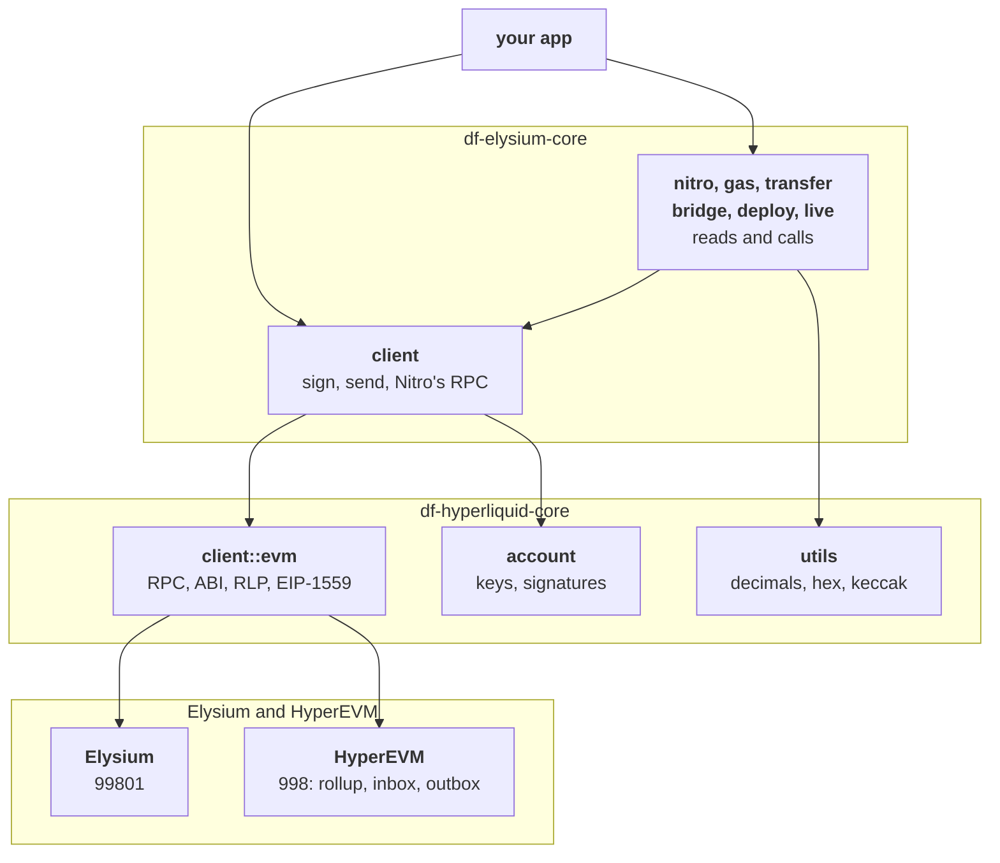

<p align="center">
  <a href="https://dfurrer.com">
    <picture>
      <source media="(prefers-color-scheme: dark)" srcset="https://dfu-cl-storybook.pages.dev/brand/markdfu-raised.svg">
      
    </picture>
  </a>
</p>

# df-elysium-core

Rust SDK for [Elysium](https://elysium.kinetiq.xyz), Kinetiq's Arbitrum Orbit chain on HyperEVM: Nitro's JSON-RPC, ArbOS precompiles, gas, HyperEVM bridging, deploys and polling, with exact amounts, signing and native or wasm transports, on df-hyperliquid-core. Testnet only until Kinetiq publishes mainnet.

## SDK

```text
df-elysium-core
├── client          the Client, the network, sends with a kept nonce
│   ├── network     testnet: chain, nodes, explorer, faucet, HyperEVM and the rollup's contracts
│   ├── rpc         receipts with L1 gas, blocks with send roots, sync sends, log windows
│   ├── records     Nitro's receipts, blocks and transaction types
│   ├── method      typed calls, events and reads
│   ├── native      reqwest, from df-hyperliquid-core (feature native)
│   └── web         fetch, from df-hyperliquid-core (feature web)
├── nitro           ArbOS's precompiles and the NodeInterface
│   ├── sys         height, chain, ArbOS version, aliasing, the way out
│   ├── gas_info    prices, HyperEVM's data price, limits, backlog
│   ├── retryable   tickets: redeem, keep alive, cancel
│   ├── wasm        Stylus: activation, parameters, cache
│   ├── node        gas split, outbox proofs, batches, confirmations
│   └── owner       chain owners, fee accounts, scheduled upgrades, and the rest
├── gas             fee caps, estimates split between Elysium and HyperEVM, costs in HYPE
├── account         signers, the kept nonce
├── transfer        HYPE, ERC-20s, Multicall3, Permit2
├── bridge          HyperEVM and back
│   ├── deposit     HYPE in through the inbox, its hash on Elysium before it lands
│   ├── retryable   calls paid on HyperEVM, ticket ids, submission fees
│   ├── withdraw    HYPE and calls out through ArbSys
│   ├── claim       BoLD assertions, outbox proofs, execution
│   └── message     what the parent chain logged, aliasing
├── deploy          creations, CREATE2, Stylus, Sourcify verification
├── live            new heads and followed logs, polled
└── utils           addresses, decimals, hex, HYPE's units
```



## Examples

Each runs against Elysium testnet. The ones that move funds sign with `ELYSIUM_TEST_KEY` (from the environment or the workspace's `.env`) and only send with `--send`; without it they prepare, simulate and print.

| Example | What it does |
|---|---|
| `cargo run -p df-elysium-core --example fees` | What a HYPE transfer costs, split between Elysium's execution and HyperEVM's data |
| `cargo run -p df-elysium-core --example chain` | Everything the chain says of itself: head, ArbOS, owners, batch posters, gas limits and prices, the confirmed outbox |
| `cargo run -p df-elysium-core --example send_hype -- --to 0x.. --amount 0.0001 --send` | Sends HYPE and prints the receipt: gas, HyperEVM's share, fee, explorer link |
| `cargo run -p df-elysium-core --example transactions -- --send` | A transaction end to end: estimated, prepared, signed and recovered, sent, awaited, read back; three more on the kept nonce, the last synchronous |
| `cargo run -p df-elysium-core --example erc20 -- --deploy --send` | An ERC-20's metadata and balance, a transfer and an approval; `--deploy` creates a token of the key's own first, `--token` names any other |
| `cargo run -p df-elysium-core --example deploy -- --send` | A contract by CREATE and by CREATE2 through the deterministic deployer, each called, and Sourcify's verdict |
| `cargo run -p df-elysium-core --example bridge_in -- --amount 0.001` | HYPE in from HyperEVM: the deposit simulated with its message number and its hash on Elysium ahead; `--track 0x..` follows a deposit to Elysium; `--send` deposits |
| `cargo run -p df-elysium-core --example bridge_out -- --amount 0.0001 --send` | HYPE out to HyperEVM: the withdrawal sent and its leaf in the outbox; `--claim 0x..` says where a withdrawal stands and simulates its claim on HyperEVM, `--send` claims it |
| `cargo run -p df-elysium-core --example retryable` | A call on Elysium paid for from HyperEVM: built, priced and simulated; `--track 0x..` follows a ticket to its redeem; `--send` submits |
| `cargo run -p df-elysium-core --example multicall` | Balances, `block.number` and a token's metadata in one call through Multicall3, one allowed to fail |
| `cargo run -p df-elysium-core --example follow -- --seconds 20` | New blocks and every withdrawal as they land, polled with `Heads` and a `LogCursor` |
| `cargo run -p df-elysium-core --example stylus -- --program 0x..` | Stylus's parameters, and a program's version, time left and activation quote |
| `cargo run -p df-elysium-core --example verify -- --address 0x..` | A contract's verification on Conduit's Sourcify; with `--input`, `--compiler` and `--contract`, submits it and waits for the job |

## Tests

```text
packages/core
├── src/**/tests       unit: records, calldata, events, precompiles, bridge hashes and proofs, nonces, polling
├── tests
│   ├── conformance    transactions, CREATE2, calldata and events match viem and @arbitrum/sdk
│   ├── mocked         whole journeys through Client against a fake Elysium and HyperEVM
│   ├── live           testnet, read only: every read, every precompile, a real claim simulated
│   └── send           testnet, real transactions from the key in .env
├── fixtures           recorded Sourcify answers
└── vectors            recorded chain answers, and what other implementations produce
```

| Command | What it runs |
|---|---|
| `just check` | format, lint, wasm, unit, conformance, mocked, the offline build, docs |
| `just live` | the live suite against Elysium and HyperEVM testnet, each answer held against its recording |
| `just send` | real transactions on Elysium testnet from `ELYSIUM_TEST_KEY` |
| `just cover` | line coverage of everything but the live and send suites |

<br>

<p align="center">
  <sub><sub><a href="https://dfurrer.com">DFU</a></sub></sub>
  &emsp;&emsp;&emsp;
  <sub><a href="https://dfurrer.com">dfurrer.com</a></sub>
  &emsp;&emsp;&emsp;
  <sub><sub><a href="https://dfurrer.com">df.hl</a></sub></sub>
</p>
